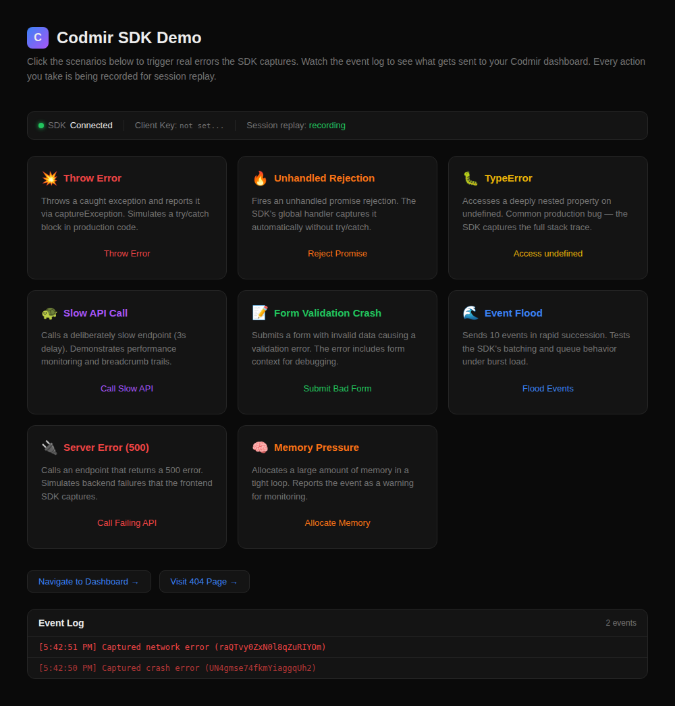
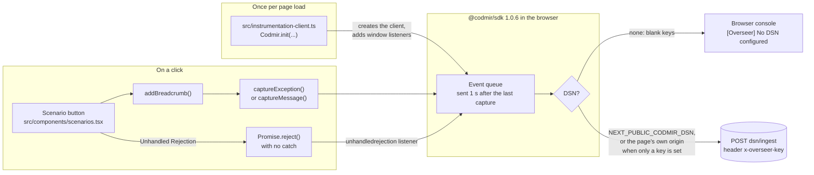
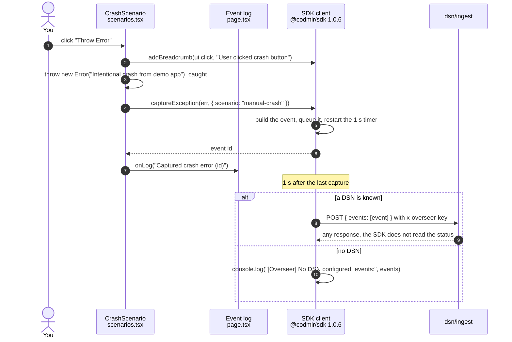

<p align="center">
  <picture>
    <source media="(prefers-color-scheme: dark)" srcset="docs/assets/hero-dark.svg">
    <source media="(prefers-color-scheme: light)" srcset="docs/assets/hero-light.svg">
    
  </picture>
</p>

<p align="center">
  <a href="LICENSE"></a>
  <a href="https://www.npmjs.com/package/@codmir/sdk"></a>
  <a href="#requirements"></a>
</p>

<p align="center">
  <a href="tsconfig.json"></a>
  <a href="package.json"></a>
  <a href="package.json"></a>
</p>

<p align="center">
  <a href="#quick-start"><b>Quick start</b></a> ·
  <a href="#what-this-example-shows"><b>What it shows</b></a> ·
  <a href="#how-it-works"><b>How it works</b></a> ·
  <a href="#what-to-look-for-in-codmir"><b>What to look for</b></a> ·
  <a href="#troubleshooting"><b>Troubleshooting</b></a> ·
  <a href="#faq"><b>FAQ</b></a> ·
  <a href="#project-layout"><b>Layout</b></a> ·
  <a href="https://codmir.com"><b>codmir.com</b></a>
</p>

Example project for codmir onboarding during installation of [`@codmir/sdk`](https://www.npmjs.com/package/@codmir/sdk).
A small [Codmir](https://codmir.com) example app built with Next.js: eight buttons, each one raises an error or sends a
message through `@codmir/sdk/nextjs`, so you can see what the SDK captures, and what it sends, before you add it to
your own app.

```bash
git clone https://github.com/codmir-labs/example.git
cd example
npm install
cp .env.example .env.local
npm run dev
```

Then open <http://localhost:3099>. With the two keys in `.env.local` left blank the app runs and the SDK sends nothing.

> [!NOTE]
> This page describes what a clean `npm install` runs: `@codmir/sdk` **1.0.6**, because `package.json` asks for
> `^1.0.0`. The latest release on npm is 2.0.1, which this example does not use. The
> [SDK README](https://github.com/codmir-labs/sdk#readme) describes the SDK's main branch, which is ahead of both
> releases, so some details differ; each one is called out below. Checked on 2026-11-23 with Node.js 22.22.1,
> `next` 15.5.29 and `react` 19.3.1.

<details>
<summary><b>Contents</b></summary>

- [What this example shows](#what-this-example-shows)
- [Quick start](#quick-start): [send events to your Codmir project](#send-events-to-your-codmir-project), [production build](#production-build), [try the API routes](#try-the-api-routes)
- [How it works](#how-it-works)
- [What to look for in Codmir](#what-to-look-for-in-codmir): [one request, field by field](#one-request-field-by-field), [what is not active in 1.0.6](#what-is-not-active-in-106)
- [Requirements](#requirements)
- [Troubleshooting](#troubleshooting)
- [FAQ](#faq)
- [Project layout](#project-layout)
- [Scripts](#scripts)
- [License](#license)

</details>

## What this example shows

Eight scenarios on one page, one second page and a 404, all wired to `@codmir/sdk/nextjs`. Each cell below is one
component in [`src/components/scenarios.tsx`](src/components/scenarios.tsx); its tile colour is the card colour in the app.

<table>
<tr>
<td width="25%" valign="top">
<br>
<b>Throw Error</b><br>
Catches an error you threw and reports it with <code>captureException</code>.
</td>
<td width="25%" valign="top">
<br>
<b>Unhandled Rejection</b><br>
Rejects a promise nobody catches; the SDK's <code>unhandledrejection</code> listener reports it.
</td>
<td width="25%" valign="top">
<br>
<b>TypeError</b><br>
Reads a property of <code>undefined</code>, catches the <code>TypeError</code> and reports it.
</td>
<td width="25%" valign="top">
<br>
<b>Slow API Call</b><br>
Calls <code>/api/slow</code>, which waits 3 seconds, then sends a warning message.
</td>
</tr>
<tr>
<td width="25%" valign="top">
<br>
<b>Form Validation Crash</b><br>
Throws a validation error and attaches the form data as context.
</td>
<td width="25%" valign="top">
<br>
<b>Event Flood</b><br>
Sends ten info messages, 100 ms apart.
</td>
<td width="25%" valign="top">
<br>
<b>Server Error (500)</b><br>
Calls <code>/api/error</code>, gets a 500 and reports it as an error.
</td>
<td width="25%" valign="top">
<br>
<b>Memory Pressure</b><br>
Allocates 1,000 arrays of 1,000 numbers, then sends a warning message.
</td>
</tr>
</table>

Around the cards:

| Where | What it does |
| --- | --- |
| Status bar, [`status-bar.tsx`](src/components/status-bar.tsx) | Says `Connected` once `getClient()` returns a client, prints the first 12 characters of the client key, and shows a fixed `recording` label for session replay |
| Event log, [`event-log.tsx`](src/components/event-log.tsx) | The newest 50 lines the scenarios write, so you can see each click land without opening the console |
| `/dashboard`, [`dashboard/page.tsx`](src/app/dashboard/page.tsx) | Adds breadcrumbs, sends one info message when it loads, and has a counter button that adds a breadcrumb per click |
| `/nonexistent-page` | The 404 page, [`not-found.tsx`](src/app/not-found.tsx), reached from the "Visit 404 Page" link |
| Error boundary, [`error.tsx`](src/app/error.tsx) | Reports a render error with `captureException` and offers "Try again". None of the eight scenarios throws while rendering, so you only see it if you add a component that does |

<p align="center">
  
</p>
<p align="center"><sub>The home page after clicking Throw Error and Call Failing API on <code>npm run dev</code> with blank keys (the Next.js dev badge is removed from the capture).</sub></p>

## Quick start

**1. Clone and install.** You need [Node.js 18.18 or later](#requirements).

```bash
git clone https://github.com/codmir-labs/example.git
cd example
npm install
```

`npm ls @codmir/sdk` prints the version you got; on the date above it is `@codmir/sdk@1.0.6`.

**2. Create `.env.local`.**

```bash
cp .env.example .env.local
```

<!-- sample: .env.example -->
```dotenv
NEXT_PUBLIC_CODMIR_CLIENT_KEY=""
CODMIR_SECRET_KEY=""
```

Both values are blank, which is enough to run the example. `.env.local` is in [`.gitignore`](.gitignore).

**3. Run it.**

```bash
npm run dev
```

The script is `next dev -p 3099`. Once it is ready the terminal prints a `Local:` line with `http://localhost:3099`. Open that address.

**4. Click a scenario.** The Event Log at the bottom of the page gets a line, and the browser console (F12) shows
`[Overseer]` lines: with blank keys, `[Overseer] No DSN configured, events:` followed by the events the SDK would have
sent. Nothing is sent anywhere.

> [!TIP]
> Events are sent one second after the last capture, so the `[Overseer]` line for a click appears about a second after
> the Event Log line.

### Send events to your Codmir project

To send events, put your values in `.env.local` and restart `npm run dev`:

```dotenv
NEXT_PUBLIC_CODMIR_CLIENT_KEY="<your client key>"
NEXT_PUBLIC_CODMIR_DSN="<your project's DSN>"
```

| Variable | Read by | What it is |
| --- | --- | --- |
| `NEXT_PUBLIC_CODMIR_CLIENT_KEY` | [`instrumentation-client.ts`](src/instrumentation-client.ts), [`status-bar.tsx`](src/components/status-bar.tsx) | Your project's client key. The SDK README says it is under **Settings > Codmir SDK** in Codmir. The SDK sends it as the `x-overseer-key` header |
| `NEXT_PUBLIC_CODMIR_DSN` | [`instrumentation-client.ts`](src/instrumentation-client.ts) | The address events are posted to. **It is not in `.env.example`; add it yourself.** The installed SDK's README writes one as `https://your-project.codmir.com/api/overseer` |
| `CODMIR_SECRET_KEY` | nothing | Listed in `.env.example`, but no file in this example reads it |

What the SDK does with them, in the browser, on 1.0.6 (the paths are inside `node_modules/@codmir/sdk/`):

| `.env.local` | What happens | Source in the installed SDK |
| --- | --- | --- |
| Both keys blank | No DSN: the SDK logs `[Overseer] No DSN configured, events:` and the events, and sends nothing | `dist/chunk-IDZI2BHU.js:1331-1336` |
| Client key only | The DSN becomes the page's own origin plus `/api/overseer`, so events go to `http://localhost:3099/api/overseer/ingest`, which this app does not serve. `npm run dev` logs `POST /api/overseer/ingest 404` and the batch is lost | `dist/chunk-IDZI2BHU.js:1145`, `:1147` |
| `NEXT_PUBLIC_CODMIR_DSN` set | Posts to the DSN plus `/ingest` (a DSN that already ends in `/ingest` is used as it is), with `x-overseer-key` when a client key is set | `dist/chunk-IDZI2BHU.js:1337-1344` |

> [!IMPORTANT]
> On 1.0.6 a client key alone does not reach Codmir; the DSN is what points the SDK at your project. The SDK README
> says a key alone defaults to `https://codmir.com/api/overseer`, but neither 1.0.6 nor 2.0.1, the latest on npm, does
> that in the browser: both build the default from the page's own origin.
>
> A DSN may not be enough. The
> [SDK changelog](https://github.com/codmir-labs/sdk/blob/main/CHANGELOG.md) says the server dropped errors sent as the
> flat event that 1.0.6 sends, behind a `200`, and lists the fix under Unreleased; see
> [What is not active in 1.0.6](#what-is-not-active-in-106).

### Production build

```bash
npm run build
npm start
```

Once a build passes, `npm start` is `next start -p 3099`, the same port as `npm run dev`. The `NEXT_PUBLIC_` values
are written into the browser bundle at build time, so rebuild after you change `.env.local`.

### Try the API routes

With the app running, two routes answer without a browser:

```bash
curl -i http://localhost:3099/api/error
curl -i http://localhost:3099/api/slow
```

| Route | Source | Response |
| --- | --- | --- |
| `GET /api/error` | [`route.ts`](src/app/api/error/route.ts) | `500` with `{"error":"Internal Server Error","message":"Simulated backend failure"}` |
| `GET /api/slow` | [`route.ts`](src/app/api/slow/route.ts) | After 3 seconds, `200` with `{"ok":true,"delayMs":3000,"message":"This response was intentionally delayed"}` |

## How it works

[`src/instrumentation-client.ts`](src/instrumentation-client.ts) is the file Next.js loads in the browser when the app
starts. It calls `Codmir.init` once, and that is the whole SDK set-up:

<!-- sample: src/instrumentation-client.ts -->
```ts
import * as Codmir from "@codmir/sdk/nextjs";

Codmir.init({
  dsn: process.env.NEXT_PUBLIC_CODMIR_DSN,
  clientKey: process.env.NEXT_PUBLIC_CODMIR_CLIENT_KEY,
  environment: "development",
  debug: true,
  sampleRate: 1.0,
  replaysOnErrorSampleRate: 1.0,
  captureUnhandledErrors: true,
  captureUnhandledRejections: true,
  trackRouteChanges: true,
});
```

`init` creates the SDK client and, in the browser, listens for `error` and `unhandledrejection` events on `window` and
records history changes (`pushState`, `replaceState`, `popstate`) as `navigation` breadcrumbs. Every scenario then
calls `addBreadcrumb` and either `captureException` or `captureMessage`; the SDK queues the event and sends the queue
one second after the last capture.



One scenario, step by step. This is Throw Error:

<!-- sample: src/components/scenarios.tsx:77-86 -->
```tsx
export function CrashScenario({ onLog }: ScenarioProps) {
  const trigger = () => {
    addBreadcrumb({ category: "ui.click", message: "User clicked crash button" });
    try {
      throw new Error("Intentional crash from demo app");
    } catch (err) {
      const id = captureException(err, { scenario: "manual-crash" });
      onLog(`Captured crash error (${id})`);
    }
  };
```

<sub>Excerpt of `src/components/scenarios.tsx`, lines 77 to 86.</sub>



When the DSN is on another origin than the page, the browser sends an `OPTIONS` preflight before each `POST`; with a
local capture server on another port, exactly one `OPTIONS` came before each `POST`. The SDK adds two headers,
`Content-Type` and `x-overseer-key`, so an endpoint on another origin has to answer that preflight.

## What to look for in Codmir

Events go to the project that owns the client key; the SDK README says the key "identifies your project". The SDK
README calls the place events appear "your dashboard" and does not name a page, so this section lists what each click
sends and leaves the screen to you. One caution before you look: the SDK changelog says the server dropped errors in the
format 1.0.6 sends; see [What is not active in 1.0.6](#what-is-not-active-in-106).

| Scenario | Event | Message and extra fields | Breadcrumb the click adds |
| --- | --- | --- | --- |
| Throw Error | `error` | `Intentional crash from demo app`; `extra.scenario` is `manual-crash` | `ui.click`: `User clicked crash button` |
| Unhandled Rejection | `error` | `Unhandled promise rejection from demo app`; `extra.handled` is `false` and `extra.mechanism` is `onunhandledrejection` | `ui.click`: `User triggered unhandled rejection` |
| TypeError | `error`, `exception.type` is `TypeError` | In Chrome, `Cannot read properties of undefined (reading 'deep')`; `extra.scenario` is `type-error` | `ui.click`: `User triggered TypeError` |
| Slow API Call | `message`, level `warning` | `Slow API call completed in 3000ms`; no `extra` | `http`: `Starting slow API call` |
| Form Validation Crash | `error` | `Validation: email is required`; `extra.scenario` is `form-validation` and `extra.formData` is `{ "email": "", "age": -5, "name": null }` | `ui.submit`: `User submitted invalid form` |
| Event Flood | ten `message` events, level `info` | `Console flood message #1` to `#10`, all in one request | `ui.click`: `User triggered console flood` |
| Server Error (500) | `error` | `API returned 500: Internal Server Error`; `extra.scenario` is `network-error` | `http`: `Calling endpoint that returns 500` |
| Memory Pressure | `message`, level `warning` | `Allocated ~4MB in loop — simulating memory pressure`; the `~4MB` is the example's own label, nothing measures memory | `ui.click`: `User triggered memory scenario` |

Two more sources of events and breadcrumbs:

- **`/dashboard`** sends an `info` message, `Dashboard page viewed`, and adds the breadcrumb
  `User landed on dashboard page`. Under `npm run dev` React Strict Mode runs the effect twice, so you get two of each,
  in one request. Each click on the counter adds a breadcrumb, `Dashboard counter clicked (N)`, with `data.clicks`; it
  sends no event by itself.
- **Navigation** adds `navigation` breadcrumbs: the first page (`data.to` is the full URL), then `replaceState`,
  `pushState` or `popstate`. They ride along with the next event; the 404 page sends no event.

Every event carries the breadcrumbs recorded so far in that page session, up to 100.

### One request, field by field

Each flush is one request:

```http
POST <dsn>/ingest
Content-Type: application/json
x-overseer-key: <your client key>
```

`x-overseer-key` is sent only when a client key is set. The body is `{ "events": [ ... ] }`. Each event has:

| Field | In this example |
| --- | --- |
| `id` | A new 21-character id, the same one the capture call returns |
| `type`, `level` | `error` and `error` for `captureException`; `message` and the level you pass for `captureMessage` (`info` or `warning` here) |
| `timestamp`, `message` | ISO 8601 time, and the error message or message text |
| `exception` | Errors only: `type`, `value`, `stacktrace[]` (`function`, `filename`, `lineno`, `colno`, `in_app`) and `mechanism` |
| `extra` | Errors only: the context object you pass, plus `conversationId` and `sessionId`, both `null` here |
| `breadcrumbs` | `category`, `message`, `timestamp` and, when given, `data` |
| `environment`, `release` | `development` (set in `init`) and `unknown` (the example sets none) |
| `sdk` | `{ "name": "@codmir/sdk", "version": "1.0.0" }` |
| `tags`, `contexts` | `{}`; `contexts` is sent on errors only |
| `user` | Absent: the example never calls `setUser` |

<details>
<summary><b>The body of one Throw Error request</b></summary>

This is the event the SDK logged for one Throw Error click on `npm run dev` with blank keys, which is the body it
would have posted. The stack is cut to its first two frames of nine; ids and times differ on every click.

<!-- sample: json-body -->
```json
{
  "events": [
    {
      "id": "Bj9exmnTqjdWfwY5xu4Y6",
      "type": "error",
      "timestamp": "2026-11-24T01:39:12.959Z",
      "level": "error",
      "message": "Intentional crash from demo app",
      "exception": {
        "type": "Error",
        "value": "Intentional crash from demo app",
        "stacktrace": [
          {
            "function": "trigger",
            "filename": "webpack-internal:///(app-pages-browser)/./src/components/scenarios.tsx",
            "lineno": 132,
            "colno": 19,
            "in_app": true
          },
          {
            "function": "executeDispatch",
            "filename": "webpack-internal:///(app-pages-browser)/./node_modules/next/dist/compiled/react-dom/cjs/react-dom-client.development.js",
            "lineno": 16971,
            "colno": 9,
            "in_app": false
          }
        ],
        "mechanism": {
          "type": "generic",
          "handled": true
        }
      },
      "tags": {},
      "extra": {
        "scenario": "manual-crash",
        "conversationId": null,
        "sessionId": null
      },
      "breadcrumbs": [
        {
          "category": "navigation",
          "message": "/",
          "data": {
            "to": "http://localhost:3099/"
          },
          "timestamp": "2026-11-24T01:39:10.260Z"
        },
        {
          "category": "navigation",
          "message": "replaceState",
          "data": {
            "to": "/"
          },
          "timestamp": "2026-11-24T01:39:10.322Z"
        },
        {
          "category": "ui.click",
          "message": "User clicked crash button",
          "timestamp": "2026-11-24T01:39:12.958Z"
        }
      ],
      "environment": "development",
      "release": "unknown",
      "sdk": {
        "name": "@codmir/sdk",
        "version": "1.0.0"
      },
      "contexts": {}
    }
  ]
}
```

</details>

### What is not active in 1.0.6

> [!WARNING]
> The page text and the status bar say session replay is recording, and `package.json` and the page metadata also
> mention self-healing patches. In this app on SDK 1.0.6 neither runs, and `recording` is a fixed label.

<details>
<summary><b>Where that comes from, and other things that look odd</b></summary>

The paths are inside `node_modules/@codmir/sdk/`, version 1.0.6.

| What you see | Why | Source |
| --- | --- | --- |
| No session replay | `replaysOnErrorSampleRate` is stored in the client config and read nowhere; the Next.js entry destructures `enableReplay` and never uses it; the example never imports `@codmir/sdk/replay`. In a run against a local capture server the only path requested was `/api/overseer/ingest` | `dist/chunk-IDZI2BHU.js:1157-1158`, `dist/nextjs/index.js:24` |
| No self-healing patches | The patch runtime starts only when `init` receives `selfHealing.enabled`; the example passes no `selfHealing` | `dist/chunk-IDZI2BHU.js:1180` |
| Status bar says `Connected` with blank keys | It means `getClient()` returned a client, which `init` always creates; no connection is made. The `recording` label is a constant in [`status-bar.tsx`](src/components/status-bar.tsx) line 49 | `dist/chunk-IDZI2BHU.js:1359-1362` |
| `sdk.version` reads `1.0.0` | The version is a string literal in the client, not read from `package.json` | `dist/chunk-IDZI2BHU.js:1217`, `:1241` |
| An unhandled rejection says `handled: true` | `exception.mechanism` is always `{ type: "generic", handled: true }`; the listener puts `handled: false` and `mechanism` in `extra` instead | `dist/chunk-IDZI2BHU.js:1205`, `dist/nextjs/index.js:38-45` |
| Event Flood has no rate limit or batch limit | One flush sends the whole queue; all ten messages left in one request | `dist/chunk-IDZI2BHU.js:1284-1295` |
| A 404 from the endpoint loses the batch | The SDK never reads the response status, and nothing retries a rejected batch | `dist/chunk-IDZI2BHU.js:1345-1349` |
| Error events may not be stored | The SDK [changelog](https://github.com/codmir-labs/sdk/blob/main/CHANGELOG.md), under Unreleased > Bug Fixes, says errors used to be sent as a flat event that the server dropped behind a `200`, and that the fix sends each error as `{ type: "error", event, group }`. 1.0.6 and 2.0.1 send the flat events shown above. This example never sent anything to a Codmir server, so that is the changelog's statement, not something measured here | `dist/chunk-IDZI2BHU.js:1337-1344`; `CHANGELOG.md` in the SDK repository, which the npm package does not include |

</details>

## Requirements

- Node.js 18.18 or later: `next` 15.5.29 declares `^18.18.0 || ^19.8.0 || >= 20.0.0`, and `@codmir/sdk` 1.0.6 asks for 18 or later.
- npm. There is no lockfile in this repository, so `npm install` resolves the newest versions each range in
  [`package.json`](package.json) allows; the versions checked are in the note at the top.
- A browser for the scenarios. The Event Log and the `[Overseer]` console lines are the browser's; the server only
  serves the pages and the two API routes.

## Troubleshooting

<details>
<summary><b>The status bar says Connected, but nothing reaches Codmir</b></summary>

`Connected` only means the SDK client exists. With blank keys the console shows `[Overseer] No DSN configured, events:`
and nothing is sent; see [Send events to your Codmir project](#send-events-to-your-codmir-project). With a DSN set, the
requests do leave the browser, but the SDK changelog says the server dropped error events in the format 1.0.6 sends; see
[What is not active in 1.0.6](#what-is-not-active-in-106).

</details>

<details>
<summary><b>The terminal prints <code>POST /api/overseer/ingest 404</code></b></summary>

Only `NEXT_PUBLIC_CODMIR_CLIENT_KEY` is set. On 1.0.6 the SDK then posts to this app's own origin, which has no such
route. Set `NEXT_PUBLIC_CODMIR_DSN` too and restart `npm run dev`.

</details>

<details>
<summary><b>A red <code>1 Issue</code> badge appears after Reject Promise</b></summary>

That is the Next.js dev indicator reporting the unhandled rejection, which is what the scenario creates.

</details>

<details>
<summary><b>I see no request in the Network tab</b></summary>

Expected with blank keys: the SDK makes no request without a DSN. With a DSN you should see one `POST` to `<dsn>/ingest`
about a second after the last capture, preceded by an `OPTIONS` when the DSN is on another origin.

</details>

<details>
<summary><b>The port is already in use</b></summary>

A second `npm run dev` on port 3099 stops with `Error: listen EADDRINUSE: address already in use :::3099`.
`npm run dev` and `npm start` both use port 3099, so stop one before you start the other.

</details>

## FAQ

<details>
<summary><b>Do I need a Codmir account to run it?</b></summary>

No. With blank keys the example runs and the SDK only logs to the browser console.

</details>

<details>
<summary><b>Is the client key a secret?</b></summary>

The SDK README says no: browsers send it with every request as `x-overseer-key`, and it identifies your project. In this
example it is a `NEXT_PUBLIC_` variable, so it is in the browser bundle, and the status bar prints its first 12
characters.

</details>

<details>
<summary><b>What does the example send?</b></summary>

Only what is in the code: the messages and context shown under [What to look for in Codmir](#what-to-look-for-in-codmir),
stack traces, and breadcrumbs. The Form Validation scenario attaches `{ "email": "", "age": -5, "name": null }`, and
navigation breadcrumbs carry full page URLs in `data.to`.

</details>

<details>
<summary><b>Can I send events to my own endpoint?</b></summary>

Yes: `NEXT_PUBLIC_CODMIR_DSN` is the address, and the SDK posts to that address plus `/ingest`. The
[SDK repository](https://github.com/codmir-labs/sdk/tree/main/examples/fullstack-basic) has an example that runs against
a local capture server.

</details>

<details>
<summary><b>Where is session replay?</b></summary>

Not active in this app on 1.0.6; see [What is not active in 1.0.6](#what-is-not-active-in-106). The
[SDK README](https://github.com/codmir-labs/sdk#session-replay) documents `startReplay()` from `@codmir/sdk/replay`.
That function is not in 1.0.6 or in 2.0.1, the latest on npm: both ship a replay entry that exports `ReplayPlayer`,
`ReplayRecorder`, `createReplayPlayer` and `createReplayRecorder`, but no `startReplay`.

</details>

## Project layout

| Path | What it holds |
| --- | --- |
| [`src/instrumentation-client.ts`](src/instrumentation-client.ts) | The SDK set-up: `Codmir.init({ ... })`, run once in the browser |
| [`src/codmir-sdk.d.ts`](src/codmir-sdk.d.ts) | A one-line type declaration for `@codmir/sdk/nextjs`. The SDK release this example installs, 1.0.6, ships no type declarations, so without this file `next build` stops at the type check. Delete it when the example moves to a release that ships types: an ambient declaration shadows real types |
| [`src/app/layout.tsx`](src/app/layout.tsx) | Root layout and the page title, `Codmir SDK Demo` |
| [`src/app/page.tsx`](src/app/page.tsx) | The home page: header, status bar, the eight scenario cards, two links and the event log |
| [`src/app/dashboard/page.tsx`](src/app/dashboard/page.tsx) | `/dashboard`: breadcrumbs, one info message on load, a click counter |
| [`src/app/error.tsx`](src/app/error.tsx) | Error boundary: `captureException` plus a "Try again" button |
| [`src/app/not-found.tsx`](src/app/not-found.tsx) | The 404 page |
| [`src/app/globals.css`](src/app/globals.css) | Colours and base styles of the dark theme |
| [`src/app/api/error/route.ts`](src/app/api/error/route.ts) | `GET /api/error`, answers 500 |
| [`src/app/api/slow/route.ts`](src/app/api/slow/route.ts) | `GET /api/slow`, answers after 3 seconds |
| [`src/components/scenarios.tsx`](src/components/scenarios.tsx) | The eight scenario components |
| [`src/components/event-log.tsx`](src/components/event-log.tsx) | The on-page list of log lines |
| [`src/components/status-bar.tsx`](src/components/status-bar.tsx) | SDK status, client key prefix and the replay label |
| [`next.config.js`](next.config.js) | Lists `@codmir/sdk` in `serverExternalPackages` and turns off the `fs`, `path`, `os` and `crypto` modules in the browser bundle |
| [`next-env.d.ts`](next-env.d.ts) | Next.js's generated type reference; not meant to be edited |
| [`tsconfig.json`](tsconfig.json) | TypeScript settings, with `strict` on |
| [`package.json`](package.json) | Scripts, dependencies and the port, 3099 |
| [`.env.example`](.env.example) | Template for `.env.local` |
| [`.gitignore`](.gitignore) | Ignores `node_modules/`, `.next/`, `.env`, `.env.local` and `dist/` |
| [`LICENSE`](LICENSE) | Apache License 2.0 |
| [`README.md`](README.md) | This page |
| [`docs/assets/`](docs/assets) | This page's hero, icons and screenshot |

## Scripts

| Command | What it runs |
| --- | --- |
| `npm run dev` | `next dev -p 3099`, the development server |
| `npm run build` | `next build`, a production build |
| `npm start` | `next start -p 3099`, serves the production build; run `npm run build` first |

## License

[Apache-2.0](LICENSE)
